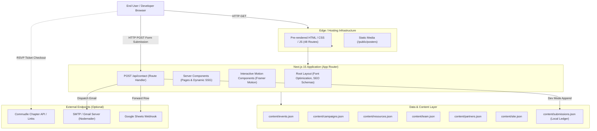

# ML Bhopal — Master Project Documentation

**Official Technical Architecture, Design System, Data Models & Operational Reference**  
*Repository Version: 2.0.0 | Production Release: September 2026*

---

## 1. Project Overview

### 1.1 What is ML Bhopal?
**ML Bhopal** (Machine Learning Bhopal) is Central India's premier community of artificial intelligence and machine learning engineers, researchers, students, and founders. Founded in April 2023 under the initial banner of **TensorFlow User Group (TFUG) Bhopal**, the organization has grown to over 3,600+ registered developers across Bhopal, Indore, Jabalpur, Gwalior, and surrounding regions. It is supported by **Google for Developers** and actively collaborates with major regional academic institutions including MANIT Bhopal, LNCT Group of Colleges, Oriental Institute of Science & Technology (OIST), IIIT Bhopal, and UIT-RGPV.

### 1.2 Purpose of the Website
The platform (`https://mlbhopal.tech`) serves as the official digital headquarters, event directory, resource publication engine, and leadership gateway for the community. It provides:
1. **Event Operations & Registration**: Centralized discovery, scheduling, and registration links for technical workshops, meetups, hackathons, and regional conferences.
2. **AI Day Flagship Portal**: Dedicated multi-edition summit portal for Central India's benchmark AI gathering (AI Day 2.0 and archived editions).
3. **Applied Technical Resources**: High-quality, production-tested architectural guides, curricula roadmaps, and code walkthroughs covering Google Gemma, TensorFlow/Keras, RAG pipelines, and LLMOps.
4. **Community Leadership Ingestion**: Formal intake funnels for collegiate Campus Ambassadors, volunteer organizers, speakers, and enterprise sponsors.

### 1.3 Target Audience
- **Undergraduate & Postgraduate Engineers**: Students learning applied machine learning and seeking hands-on workshops, collegiate chapters, and internship pipelines.
- **Practitioners & Software Engineers**: Developers shipping production LLM apps, fine-tuning open-weights models, and optimizing cloud compute.
- **Academic Deans & Faculty Coordinators**: University leadership seeking official MoUs and Google-backed developer curricula.
- **Industry Partners & Sponsors**: Technology organizations looking to support hackathons, sponsor conference tracks, or hire regional engineering talent.

---

## 2. Product Architecture

The platform is built as a modern, high-performance web application utilizing **Next.js 15 (App Router)** and **React 19**, styled with **Tailwind CSS**, and animated with **Framer Motion 12**. All public content pages are pre-rendered into static HTML at build time (SSG), resulting in sub-second load times, optimal SEO indexing, and zero database dependencies for content delivery.

### 2.1 System Architecture Diagram



---

## 3. Technology Stack

Every dependency listed below is verified directly against [`package.json`](file:///c:/Users/HP/Downloads/redesign%20antigravity/package.json):

| Technology | Verified Version | Purpose & Responsibility |
| :--- | :--- | :--- |
| **Next.js** | `^15.1.7` (Engine: 15.5.26) | App Router, SSG static pre-rendering, image optimization, API route handling |
| **React** | `^19.0.0` | Declarative UI component library |
| **React DOM** | `^19.0.0` | DOM rendering and hydration |
| **TypeScript** | `^5.7.3` | End-to-end static type safety and build verification |
| **Tailwind CSS** | `^3.4.17` | Utility-first styling engine and custom design token system |
| **Framer Motion** | `^12.4.7` | UI transitions, spring dynamics, staggered lists, gliding tabs, layout animations |
| **Lucide React** | `^0.475.0` | Accessible, clean UI iconography |
| **Canvas Confetti** | `^1.9.4` | Client celebration micro-interaction on CTA button click |
| **Nodemailer** | `^6.9.16` | Server-side SMTP delivery for lead ingestion forms |
| **Three.js** | `^0.174.0` | WebGL library (kept as dependency; heavy particle spiderwebs replaced with clean SVG nodes) |
| **clsx** | `^2.1.1` | Conditional className concatenation utility |
| **tailwind-merge** | `^3.0.1` | Conflict-free Tailwind class resolution utility |
| **class-variance-authority** | `^0.7.1` | Component variant construction helper |
| **PostCSS** | `^8.5.2` | CSS transformation pipeline |
| **Autoprefixer** | `^10.4.20` | Vendor prefix automation |

*(Note: GSAP is NOT installed or utilized in the repository. All animations are powered by Framer Motion, CSS transitions, and SVG transforms).*

---

## 4. Repository Structure

The actual file and directory tree of the repository:

```text
ml-bhopal-website/
├── .env.example                # Environment variables template with documentation
├── .gitignore                  # Git ignore rules for node_modules, .next, etc.
├── CHANGELOG.md                # Version history and notable release changes
├── CONTRIBUTING.md             # Developer contribution guidelines and design rules
├── PROJECT_DOCUMENTATION.md    # Master technical documentation (this document)
├── README.md                   # Concise repository landing documentation
├── next-env.d.ts               # Next.js TypeScript ambient type definitions
├── next.config.ts              # Next.js configuration (images, redirects, packages)
├── package.json                # Project dependencies, metadata, and scripts
├── package-lock.json           # Exact dependency lockfile
├── postcss.config.mjs          # PostCSS configuration for Tailwind CSS
├── tailwind.config.ts          # Material Design tokens, color palette, shadows, radiuses
├── tsconfig.json               # TypeScript compiler configuration with @/* path aliases
│
├── app/                        # Next.js App Router (Routes, Layouts, APIs)
│   ├── layout.tsx              # Root HTML shell, Inter font, SEO Organization schema
│   ├── globals.css             # Tailwind base layers, scrollbars, reduced motion overrides
│   ├── page.tsx                # Homepage (Hero, Metrics, Pillars, AI Day, Partners, CTA)
│   ├── error.tsx               # Global React error boundary component
│   ├── not-found.tsx           # Global 404 handler with return navigation
│   ├── robots.ts               # Automated robots.txt endpoint
│   ├── sitemap.ts              # Automated XML sitemap endpoint (indexes all 42 URLs)
│   │
│   ├── about/
│   │   └── page.tsx            # Community history, principles, and timeline
│   ├── ai-day/
│   │   └── page.tsx            # Flagship AI Day portal, speaker agenda, edition switcher
│   ├── ambassador/
│   │   ├── layout.tsx          # Campus Ambassador route metadata
│   │   └── page.tsx            # Campus chapter roadmap, benefits, and application form
│   ├── campaigns/
│   │   ├── page.tsx            # Active, upcoming, and completed community campaigns
│   │   └── [slug]/
│   │       └── page.tsx        # Dynamic campaign landing page (SSG for 4 campaigns)
│   ├── contact/
│   │   ├── layout.tsx          # Contact route metadata
│   │   └── page.tsx            # General inquiry form, email channels, and FAQs
│   ├── events/
│   │   ├── page.tsx            # Filterable event explorer (search, format, year)
│   │   └── [slug]/
│   │       └── page.tsx        # Dynamic event chronicle (SSG for 21 events)
│   ├── join/
│   │   ├── layout.tsx          # Volunteer collective route metadata
│   │   └── page.tsx            # Volunteer tracks (Ops, Tech, Media, Outreach) & form
│   ├── partners/
│   │   └── page.tsx            # Academic network, tier packages, and inquiry form
│   ├── resources/
│   │   ├── page.tsx            # Technical articles, cookbooks, and tag filter
│   │   └── [slug]/
│   │       └── page.tsx        # Dynamic technical article reader (SSG for 6 guides)
│   ├── team/
│   │   └── page.tsx            # Community leads, core organizers, and bios
│   └── api/
│       └── contact/
│           └── route.ts        # POST endpoint for lead ingestion with spam protection
│
├── components/                 # Reusable React UI & Motion Components
│   ├── 3d/
│   │   └── SubtleNeuralCanvas.tsx   # Lightweight placeholder (zero WebGL overhead)
│   ├── aiday/
│   │   └── AIDayEditionSwitcher.tsx # Gliding pill tab switcher between summit editions
│   ├── campaigns/
│   │   └── CampaignCard.tsx         # Material campaign card with status indicators
│   ├── events/
│   │   ├── EventCard.tsx            # Event listing card with hover-lift & calendar chips
│   │   ├── EventFilters.tsx         # Multi-format filter chips (All, Flagship, Meetup, etc.)
│   │   ├── EventStickyBar.tsx       # Bottom-docked sticky RSVP action bar
│   │   └── EventsExplorer.tsx       # Search and filter state container with popLayout
│   ├── home/
│   │   ├── AIDaySpotlight.tsx       # Flagship summit homepage highlight card
│   │   ├── CampaignsSpotlight.tsx   # Active build sprints showcase
│   │   ├── CampusPrograms.tsx       # 4-step campus chapter roadmap
│   │   ├── CommunityMetrics.tsx     # 4 animated stat counters (3,600+, 21+, 9+, 100%)
│   │   ├── CommunityPeople.tsx      # Community organizer spotlight
│   │   ├── EcosystemPartners.tsx    # Academic institute and partner grid
│   │   ├── FinalCTA.tsx             # Call-to-action banner with confetti trigger
│   │   ├── HomeHero.tsx             # Choreographed hero headline, CTAs, and node canvas
│   │   ├── ResourcesPreview.tsx     # Technical guide preview cards
│   │   ├── UpcomingEvents.tsx       # Upcoming and recent event showcase
│   │   └── WhatWeDo.tsx             # 5 core operational pillars with staggered entrance
│   ├── layout/
│   │   ├── Breadcrumbs.tsx          # Accessible breadcrumb navigation
│   │   ├── Container.tsx            # Max-width layout containment utility
│   │   ├── Footer.tsx               # 4-column structured directory and legal footer
│   │   ├── Header.tsx               # Sticky navbar with mobile menu & scroll lock
│   │   └── Section.tsx              # Standardized vertical section padding wrapper
│   ├── motion/
│   │   ├── AnimatedAccordion.tsx    # AnimatePresence FAQ accordion with rotating chevron
│   │   ├── AnimatedCounter.tsx      # 60fps requestAnimationFrame numerical counter
│   │   ├── AnimatedTabs.tsx         # Reusable tab list with layoutId gliding pill
│   │   ├── ScrollReveal.tsx         # Viewport-triggered fade/slide reveal wrapper
│   │   └── StaggerContainer.tsx     # Staggered children container and item wrappers
│   ├── partners/
│   │   └── PartnerInquiryForm.tsx   # Dynamic client partnership proposal form
│   ├── resources/
│   │   ├── ArticleContentRenderer.tsx # Markdown renderer for headings, code, and tables
│   │   ├── CodeBlock.tsx            # DevSite-styled syntax-highlighted code block
│   │   ├── ReadingProgress.tsx      # Top-docked reading scroll progress indicator
│   │   ├── ResourceCard.tsx         # Publication card with hover-lift & tag metadata
│   │   ├── ResourcesExplorer.tsx    # Client publication filter and search bar
│   │   └── TableOfContents.tsx      # Sticky sidebar article table of contents
│   └── ui/
│       ├── Badge.tsx                # High-contrast chip badges (Google, Blue, Green, etc.)
│       ├── GoogleConnectedNodes.tsx # Interactive floating 4-node Google developer graphic
│       ├── PrimaryButton.tsx        # Tactile Google Blue primary action button
│       ├── SecondaryButton.tsx      # Subtle tonal secondary action button
│       ├── SectionHeader.tsx        # Standardized section title, eyebrow, and subtitle
│       └── Tag.tsx                  # Domain tag chip component
│
├── content/                    # Data Layer (JSON Data Files)
│   ├── campaigns.json          # 4 verified campaigns (Build with AI, Hackathon, TPU, Kaggle)
│   ├── events.json             # 21 verified community events and metadata
│   ├── partners.json           # Academic institutes, community partners, and tiers
│   ├── resources.json          # 6 full-length technical markdown articles
│   ├── site.json               # General community stats, testimonials, and FAQs
│   ├── submissions.json        # Local file-based submission ledger for development
│   ├── team.json               # Community leads and core organizer records
│   └── blog/                   # Archived MDX post files
│
├── lib/                        # Utilities, Data Loaders, and Motion Tokens
│   ├── data.ts                 # Type-safe getters for events, campaigns, team, articles
│   ├── motion.ts               # Material Design 3 duration, easing, spring tokens
│   ├── types.ts                # TypeScript interfaces for all data entities
│   └── utils.ts                # cn() class merge helper and date formatters
│
└── public/                     # Static Public Assets
    └── posters/
        ├── ml-bhopal-banner.html # HTML canvas banner asset
        └── ml-bhopal-banner.png  # Open Graph and metadata preview image
```

---

## 5. Application Routes

Every route is automatically pre-rendered at build time:

| Route Path | Type | File Source | Purpose & Description |
| :--- | :--- | :--- | :--- |
| `/` | Static | `app/page.tsx` | Platform homepage: Hero, stats, pillars, AI Day banner, partners |
| `/_not-found` | Static | `app/not-found.tsx` | 404 Error handler with search recommendations |
| `/about` | Static | `app/about/page.tsx` | Community origin story, 4 core pillars, historical timeline |
| `/ai-day` | Static | `app/ai-day/page.tsx` | AI Day summit portal with edition switcher, agenda, and speakers |
| `/ambassador` | Static | `app/ambassador/page.tsx` | Campus chapter leadership program, roadmap, and application form |
| `/api/contact` | Dynamic (API) | `app/api/contact/route.ts` | Server-side form processing, rate limiting, and email delivery |
| `/campaigns` | Static | `app/campaigns/page.tsx` | Community sprints and hackathons directory |
| `/campaigns/[slug]` | SSG (4 paths) | `app/campaigns/[slug]/page.tsx` | Dynamic campaign landing pages: overview, schedule, perks, FAQs |
| `/contact` | Static | `app/contact/page.tsx` | General inquiries, speaker proposals, and community email channels |
| `/events` | Static | `app/events/page.tsx` | Searchable and filterable archive of all 21 community gatherings |
| `/events/[slug]` | SSG (21 paths) | `app/events/[slug]/page.tsx` | Dynamic event chronicle: venue maps, keynotes, schedule, RSVP |
| `/join` | Static | `app/join/page.tsx` | Volunteer collective tracks (Ops, Tech, Media, Outreach) & form |
| `/partners` | Static | `app/partners/page.tsx` | University network, sponsorship tier matrix, and proposal portal |
| `/resources` | Static | `app/resources/page.tsx` | Technical engineering guides, cookbooks, and learning roadmaps |
| `/resources/[slug]` | SSG (6 paths) | `app/resources/[slug]/page.tsx` | Dynamic long-form technical article reader with Table of Contents |
| `/robots.txt` | Static | `app/robots.ts` | Search crawler instructions specifying sitemap location |
| `/sitemap.xml` | Static | `app/sitemap.ts` | XML sitemap indexing all 42 primary and dynamic pages |
| `/team` | Static | `app/team/page.tsx` | Community leads, core team directory, bios, and LinkedIn links |

**Total Generated Pages: 48 Routes** (All static or SSG prerendered; 0 runtime failures).

---

## 6. Page-by-Page Technical Breakdown

### 6.1 Homepage (`/`)
- **Purpose**: Welcomes developers, establishes official Google for Developers affiliation, presents verified metrics, and directs users to active sprints.
- **Main Sections**: `HomeHero`, `CommunityMetrics`, `WhatWeDo`, `CampaignsSpotlight`, `UpcomingEvents`, `AIDaySpotlight`, `CampusPrograms`, `ResourcesPreview`, `EcosystemPartners`, `FinalCTA`.
- **Data Source**: `getFeaturedEvents()`, `getFeaturedCampaign()`, `getResources()`, `getPartners()`, and `content/site.json`.
- **Key Interactions**: Choreographed hero load, floating node animation, animated count-up metrics, card hover lifts, confetti trigger on Commudle button.
- **SEO**: Primary metadata with canonical URL `https://mlbhopal.tech` and Schema.org `Organization`.

### 6.2 Events Directory & Event Detail (`/events`, `/events/[slug]`)
- **Purpose**: Comprehensive record of every workshop, meetup, and conference hosted by the community.
- **Components**: `EventsExplorer`, `EventCard`, `EventFilters`, `EventStickyBar`, `Breadcrumbs`.
- **Data Source**: `content/events.json` via `getEvents()`, `getEventBySlug()`.
- **Key Interactions**: Instant live text search, category filter pills (Meetups, Workshops, Flagship), year selector, smooth card re-flow using Framer Motion `layout` and `<AnimatePresence mode="popLayout">`.
- **Detail Features**: Sticky RSVP bar with status badge, date chip, venue address with Google Maps redirect, speaker roster, and Schema.org `Event` structured data.

### 6.3 AI Day Summit Portal (`/ai-day`)
- **Purpose**: Dedicated flagship conference hub for Central India's benchmark gathering.
- **Components**: `AIDayEditionSwitcher`, `Breadcrumbs`, `PrimaryButton`, `Badge`.
- **Data Source**: Filtered `getAIDayEvents()` records.
- **Key Interactions**: Segmented edition switcher (AI Day 2.0 vs 1.0) with gliding blue pill indicator and smooth cross-fade transitions via `<AnimatePresence mode="wait">`.
- **SEO**: Dedicated `Event` JSON-LD schema with startDate, location, and attendee capacity.

### 6.4 Campus Ambassador Program (`/ambassador`)
- **Purpose**: Student leadership portal for launching official collegiate chapters.
- **Components**: 4-step roadmap grid, responsibility cards, verified deliverables, `AnimatedAccordion` FAQ, application form.
- **Form State**: Full name, email, phone/WhatsApp, college, branch, study year, portfolio link, experience, vision statement.
- **Key Interactions**: Smooth accordion expansion, client form validation, honeypot spam guard.

### 6.5 Volunteer Collective (`/join`)
- **Purpose**: Recruitment portal for the voluntary organizing team.
- **Components**: Track cards (Operations, Tech Mentorship, Creative Design, Outreach), process roadmap, expectations, `AnimatedAccordion` FAQ, volunteer application form.
- **Interactions**: Clicking "Apply for this track" automatically populates the form's dropdown and smoothly scrolls into view.

### 6.6 Technical Resources & Guides (`/resources`, `/resources/[slug]`)
- **Purpose**: Applied developer documentation covering Gemma 2, TensorFlow, RAG evaluation, and AI security.
- **Components**: `ResourcesExplorer`, `ResourceCard`, `TableOfContents`, `CodeBlock`, `ReadingProgress`, `ArticleContentRenderer`.
- **Data Source**: `content/resources.json`.
- **Features**: Top scroll progress bar, sticky Table of Contents highlighting active section, syntax-highlighted code blocks with 1-click clipboard copy, and Schema.org `Article` structured data.

---

## 7. Component Architecture

All components are organized into modular, purpose-driven directories under `components/`:

### 7.1 Layout Components (`components/layout/*`)
- **`Header.tsx`**: Clean white sticky navigation bar with `#DADCE0` bottom border, Google Developer brand badge, desktop nav links, mobile drawer with body scroll lock, and Commudle action button.
- **`Footer.tsx`**: 4-column directory featuring navigation links, social channel links (Commudle, Luma, LinkedIn, X, GitHub), official community affiliation disclaimer, and copyright.
- **`Container.tsx`**: Reusable max-width container supporting `default` (1280px), `sm` (768px), `lg` (1440px), and `full`.
- **`Section.tsx`**: Standardized vertical padding wrapper supporting `sm` (py-8), `md` (py-12), `lg` (py-16), and `xl` (py-24), with background variants (`base`, `subtle`, `white`).
- **`Breadcrumbs.tsx`**: High-contrast hierarchical navigation links with Schema.org breadcrumb compatibility.

### 7.2 Core UI Components (`components/ui/*`)
- **`PrimaryButton.tsx`**: Tactile Google Blue (`#1A73E8`) button with `active:scale-[0.98]` physical press feedback, `group-hover:translate-x-0.5` icon nudge, and accessible focus rings.
- **`SecondaryButton.tsx`**: Neutral tonal button with `#F1F3F4` fill, `#DADCE0` outline, and active press feedback.
- **`Badge.tsx`**: Semantic chip badge supporting variants: `google`, `blue`, `green`, `yellow`, `red`, and `neutral`.
- **`SectionHeader.tsx`**: Standardized section header with uppercase eyebrow chip, bold display headline, and description paragraph.
- **`GoogleConnectedNodes.tsx`**: Clean SVG graphic depicting 4 interconnected Google-colored nodes oscillating gently with out-of-phase sine wave animations.
- **`Tag.tsx`**: Technical domain tag chip.

### 7.3 Motion Primitives (`components/motion/*`)
- **`ScrollReveal.tsx`**: Viewport-triggered fade/slide reveal wrapper with reduced-motion bypass.
- **`StaggerContainer.tsx`**: Container orchestrating staggered cascading entrances (`0.07s` interval).
- **`AnimatedCounter.tsx`**: Numerical counter running on `requestAnimationFrame` with cubic ease-out.
- **`AnimatedAccordion.tsx`**: Collapsible container with animated height expansion and rotating chevron.
- **`AnimatedTabs.tsx`**: Gliding pill tab selector using Framer Motion `layoutId`.

---

## 8. Design System Specification

The visual design system strictly follows **Google Developer and Material Design 3 guidelines**.

### 8.1 Color Palette
```css
/* Google Semantic Brand Accents */
--google-blue:        #1A73E8;  /* Primary brand, active states, key CTAs */
--google-blue-dark:   #0B57D0;  /* Button hover state */
--google-blue-light:  #E8F0FE;  /* Tonal badge background */
--google-green:       #34A853;  /* Success indicators, verified badges */
--google-green-light: #E6F4EA;  /* Success tonal background */
--google-yellow:      #FBBC04;  /* Warnings, active cohort indicators */
--google-yellow-light:#FEF7E0;  /* Yellow tonal background */
--google-red:         #EA4335;  /* Error alerts, deadlines, critical tags */
--google-red-light:   #FCE8E6;  /* Error alert background */

/* Backgrounds & Surfaces (Light First) */
--background:         #F8F9FA;  /* Primary canvas background */
--surface:            #FFFFFF;  /* Primary card and modal surface */
--surface-secondary:  #F1F3F4;  /* Subtle secondary surface / input fill */

/* Typography & Contrast */
--ink-primary:        #202124;  /* Headings, high-emphasis text (13.5:1 contrast) */
--ink-secondary:      #5F6368;  /* Body copy, descriptions (4.8:1 contrast) */
--ink-tertiary:       #80868B;  /* Captions, dates, metadata (3.2:1 contrast) */
--ink-disabled:       #BDC1C6;  /* Placeholder text, disabled controls */

/* Borders & Outlines */
--border:             #DADCE0;  /* Standard card and input outline */
--border-light:       #E8EAED;  /* Subtle card divider */
```

### 8.2 Typography Hierarchy
- **Primary Font Family**: `Inter`, `Roboto`, `system-ui`, `sans-serif` (loaded via Next.js `Inter({ subsets: ["latin"], variable: "--font-sans" })`).
- **Display Font Family**: Inherits `Inter` with extrabold tracking (`tracking-tight`).
- **Monospace Family**: `JetBrains Mono`, `monospace` (loaded via Next.js `JetBrains_Mono({ subsets: ["latin"], variable: "--font-mono" })`).
- **Heading Scale**:
  - `Hero H1`: `text-4xl sm:text-6xl font-extrabold tracking-tight leading-[1.08]`
  - `Section H2`: `text-2xl sm:text-4xl font-bold tracking-tight text-ink-primary`
  - `Card H3`: `text-lg sm:text-xl font-semibold text-ink-primary`
  - `Eyebrow Tag`: `text-xs font-semibold uppercase tracking-wider text-google-blue`

### 8.3 Border Radiuses
- **`rounded-control` (8px)**: Buttons, text inputs, select dropdowns, filter chips.
- **`rounded-card` (16px)**: Event cards, campaign cards, resource cards, pillar cards.
- **`rounded-surface` (24px)**: Hero containers, AI Day spotlight panel, callout banners.

### 8.4 Surface Elevations
- **`shadow-subtle`**: `0 1px 2px 0 rgba(60,64,67, 0.1), 0 1px 3px 0 rgba(60,64,67, 0.08)` (resting card state).
- **`shadow-elevation-1`**: `0 1px 2px 0 rgba(60,64,67, 0.3), 0 1px 3px 1px rgba(60,64,67, 0.15)` (interactive hover state).
- **`shadow-card-hover`**: `0 4px 12px 0 rgba(60,64,67, 0.12), 0 1px 3px 0 rgba(60,64,67, 0.1)` (elevated card hover).

---

## 9. Motion & Animation System

Defined in [`lib/motion.ts`](file:///c:/Users/HP/Downloads/redesign%20antigravity/lib/motion.ts) following **Material Design 3 principles**:

### 9.1 Motion Tokens
```typescript
export const DURATION = {
  micro: 0.14,  // Button active press, icon nudges (140ms)
  small: 0.2,   // Tabs, chips, tooltips, dropdowns (200ms)
  medium: 0.32, // Card elevation, accordions, dialogs (320ms)
  large: 0.48,  // Viewport scroll reveals, mobile drawer (480ms)
  hero: 0.65,   // Staggered hero load choreography (650ms)
};

export const EASING = {
  standard: [0.2, 0.0, 0.0, 1.0],   // MD3 standard transition curve
  decelerate: [0.0, 0.0, 0.2, 1.0], // MD3 incoming elements
  accelerate: [0.4, 0.0, 1.0, 1.0], // MD3 exiting elements
};

export const SPRING = {
  snappy: { stiffness: 400, damping: 30 }, // Tabs, filter switches
  gentle: { stiffness: 200, damping: 24 }, // Floating node physics
};
```

### 9.2 Reduced Motion Strategy
1. **CSS Universal Fallback (`app/globals.css`)**:
   ```css
   @media (prefers-reduced-motion: reduce) {
     *, ::before, ::after {
       animation-duration: 0.01ms !important;
       animation-iteration-count: 1 !important;
       transition-duration: 0.01ms !important;
       scroll-behavior: auto !important;
     }
   }
   ```
2. **Framer Motion React Hooks**:
   Components call `const shouldReduceMotion = useReducedMotion();`. When enabled, transforms (`y: 20`, `scale`, `rotate`) are zeroed and durations resolve to `0`.
3. **Canvas Confetti**:
   Explicitly checks `window.matchMedia("(prefers-reduced-motion: reduce)").matches` and activates `disableForReducedMotion: true`.

---

## 10. Data Architecture

The platform operates on a structured, file-based data architecture located in `content/*.json`, loaded via type-safe utility functions in `lib/data.ts`.

### 10.1 Data Models (`lib/types.ts`)
- **`Event`**: Identifies community gatherings (`slug`, `title`, `date`, `venue`, `registrations`, `type`, `status`, `speakers`, `collaborators`, `schedule`, `commudleUrl`).
- **`Campaign`**: Identifies multi-week sprints and hackathons (`slug`, `title`, `description`, `status`, `category`, `whyJoin`, `benefits`, `timeline`, `registrationUrl`).
- **`ResourceArticle`**: Identifies technical markdown articles (`slug`, `title`, `category`, `author`, `readingTime`, `tableOfContents`, `content`).
- **`TeamMember`**: Identifies community organizers (`name`, `role`, `company`, `bio`, `linkedin`, `avatar`).
- **`Partner`**: Identifies academic institutions and sponsors (`name`, `type`, `url`).

### 10.2 Data Loaders (`lib/data.ts`)
```typescript
getEvents(): Event[]
getFeaturedEvents(): Event[]
getUpcomingEvents(): Event[]
getPastEvents(): Event[]
getEventBySlug(slug: string): Event | undefined
getAIDayEvents(): Event[]

getCampaigns(): Campaign[]
getFeaturedCampaign(): Campaign | undefined
getCampaignBySlug(slug: string): Campaign | undefined

getTeamMembers(): TeamMember[]
getTeamLeads(): TeamMember[]
getCoreTeam(): TeamMember[]

getPartners(): Partner[]
getPartnersFullData(): { current: Partner[]; past: Partner[]; sponsorshipTiers: any[] }

getResourceArticles(): ResourceArticle[]
getResourceArticleBySlug(slug: string): ResourceArticle | undefined
```

---

## 11. API Documentation

### Endpoint: `POST /api/contact`
The platform features a unified, server-side API route handler in [`app/api/contact/route.ts`](file:///c:/Users/HP/Downloads/redesign%20antigravity/app/api/contact/route.ts) that processes all contact, ambassador, volunteer, and partnership submissions.

#### Request Headers
```http
POST /api/contact HTTP/1.1
Content-Type: application/json
```

#### Request Payload Schema
```json
{
  "type": "ambassador", // "ambassador" | "volunteer" | "partner" | "general" | "contact"
  "name": "Yash Vardhan", // Required, string, 2-100 chars
  "email": "yash@example.com", // Required, valid email format, max 150 chars
  "phone": "+91 98765 43210", // Optional, string, max 30 chars
  "college": "LNCT Bhopal", // Optional, string, max 150 chars
  "branch": "Computer Science (AI)", // Optional, string, max 100 chars
  "year": "3rd Year", // Optional, string, max 50 chars
  "company": "", // Optional, string, max 150 chars
  "role": "", // Optional, string, max 100 chars
  "tier": "", // Optional, string, max 50 chars
  "portfolio": "https://linkedin.com/in/...", // Optional, valid URL
  "experience": "Lead of campus coding society...", // Optional, string, max 3000 chars
  "message": "Vision for our university chapter...", // Optional, string, max 5000 chars
  "subject": "", // Optional, string, max 150 chars
  "hp_field": "", // Honeypot spam trap (must be empty)
  "_submittedAt": 1774390000000 // Form render timestamp (ms)
}
```

#### Security & Validation Features
1. **In-Memory Rate Limiting**: Enforces a strict threshold of **max 5 requests per IP per 60 seconds**. Exceeding returns `429 Too Many Requests`.
2. **Honeypot Anti-Spam Trap**: The form includes an invisible `hp_field` positioned off-screen. Automated spambots filling this field receive immediate `400 Bad Request`.
3. **Sub-Second Fast-Bot Detection**: If the time difference between form mount (`_submittedAt`) and submission is `< 600ms`, the request is flagged as an automated script and rejected.
4. **Header Injection & XSS Sanitization**: All incoming fields are sanitized with `sanitizeHeader()`, `escapeHtml()`, and `sanitizeUrl()` before inclusion in notifications.

#### Storage & Dispatch Logic
- **Development Mode**: Appends the submission record to [`content/submissions.json`](file:///c:/Users/HP/Downloads/redesign%20antigravity/content/submissions.json) for instant local verification.
- **Google Sheets Webhook**: If `GOOGLE_SHEET_WEBHOOK_URL` is set, dispatches a background POST request with the submission row.
- **SMTP Email**: If `SMTP_USER` and `SMTP_PASS` (or `GMAIL_USER` and `GMAIL_APP_PASSWORD`) are set, delivers a branded HTML notification email via `nodemailer` to `NOTIFICATION_EMAIL`.

#### Response Examples
**Success (`200 OK`)**:
```json
{
  "success": true,
  "message": "Your submission has been securely delivered to the ML Bhopal team."
}
```

**Validation Error (`400 Bad Request`)**:
```json
{
  "error": "Please enter your full name (minimum 2 characters)."
}
```

**Rate Limited (`429 Too Many Requests`)**:
```json
{
  "error": "Too many submissions. Please wait a minute before trying again."
}
```

---

## 12. Environment Variables

All environment variables used by the codebase are optional for local development.

| Variable Name | Required | Default / Fallback | Purpose |
| :--- | :---: | :--- | :--- |
| `NOTIFICATION_EMAIL` | No | `"contact@mlbhopal.tech"` | Recipient email address for inbound form submissions |
| `GOOGLE_SHEET_WEBHOOK_URL` | No | `undefined` | Google Apps Script webhook to record submissions in Google Sheets |
| `SMTP_HOST` | No | `"smtp.gmail.com"` | Outgoing SMTP server hostname |
| `SMTP_PORT` | No | `465` | Outgoing SMTP server port (465 for SSL, 587 for TLS) |
| `SMTP_USER` | No | `undefined` | SMTP authentication username / email |
| `SMTP_PASS` | No | `undefined` | SMTP authentication password |
| `GMAIL_USER` | No | `undefined` | Gmail alias for `SMTP_USER` |
| `GMAIL_APP_PASSWORD` | No | `undefined` | Gmail alias for `SMTP_PASS` (16-character App Password) |
| `NODE_ENV` | System | `"development"` / `"production"` | Controls local ledger writes and Next.js optimization |

*Template available at [`.env.example`](file:///c:/Users/HP/Downloads/redesign%20antigravity/.env.example).*

---

## 13. Content Management Guide

Maintainers can add, modify, or archive content by editing JSON records in `content/` without altering application code:

### 13.1 Adding an Event
1. Open `content/events.json`.
2. Append a new object following the `Event` schema:
   ```json
   {
     "id": "deep-dive-gemma-2026",
     "title": "Deep Dive into Gemma 2 & Agentic Workflows",
     "slug": "deep-dive-gemma-2026",
     "date": "2026-07-15",
     "type": "workshop",
     "status": "upcoming",
     "venue": "MANIT Bhopal",
     "registrations": 0,
     "commudleUrl": "https://www.commudle.com/communities/ml-bhopal/events/deep-dive-gemma-2026",
     "description": "Hands-on code sprint building autonomous agents with Gemma 2.",
     "speakers": ["Rishabh Gupta"],
     "collaborators": ["Google for Developers", "MANIT Bhopal"],
     "featured": true
   }
   ```
3. Run `npm run build` to verify that Next.js pre-renders `/events/deep-dive-gemma-2026` and updates the XML sitemap.

### 13.2 Adding a Technical Article
1. Open `content/resources.json`.
2. Append a new object with unique `slug`, `title`, `tableOfContents`, and markdown `content`.
3. The reader at `/resources/[slug]` automatically renders the table of contents, reading time, code blocks, and Article structured data.

---

## 14. SEO & Structured Data Architecture

### 14.1 Global SEO Setup
- **`metadataBase`**: Configured to `https://mlbhopal.tech` in `app/layout.tsx`.
- **Title Strategy**: Root title uses template: `%s | ML Bhopal`.
- **Open Graph & Twitter Cards**: `summary_large_image` referencing `/posters/ml-bhopal-banner.png` (1200x630px).
- **Robots Endpoint (`/robots.txt`)**: Allows root crawling, disallows `/api/`, specifies `sitemap: https://mlbhopal.tech/sitemap.xml`.
- **Sitemap Endpoint (`/sitemap.xml`)**: Dynamically indexes all 42 public content pages with prioritized change frequencies.

### 14.2 Schema.org Structured Data
1. **Organization (`app/layout.tsx`)**:
   ```json
   {
     "@context": "https://schema.org",
     "@type": "Organization",
     "name": "ML Bhopal",
     "alternateName": ["TFUG Bhopal", "Machine Learning Bhopal"],
     "url": "https://mlbhopal.tech",
     "foundingDate": "2023",
     "sameAs": [
       "https://www.commudle.com/communities/ml-bhopal",
       "https://www.linkedin.com/company/ml-bhopal",
       "https://x.com/ml_bhopal",
       "https://github.com/ml-bhopal"
     ]
   }
   ```
2. **Event (`app/ai-day/page.tsx`, `app/events/[slug]/page.tsx`)**: Includes event name, date, venue address, and registration URL.
3. **Article (`app/resources/[slug]/page.tsx`)**: Includes headline, author credentials, publication date, and description.

---

## 15. Accessibility & Responsive Implementation

### 15.1 Accessibility (WCAG 2.1 AA Standards)
- **Skip to Main Content**: Root keyboard bypass link jumping directly to `#main-content`.
- **Keyboard Navigation**: All interactive elements (buttons, links, tabs, accordion triggers) are natively focusable with high-contrast Google Blue outline (`focus-visible:ring-2 focus-visible:ring-google-blue`).
- **Semantic HTML**: Strict heading hierarchy (`h1` -> `h2` -> `h3`), `<main>`, `<article>`, `<nav>`, `<aside>`, and `<header>` regions.
- **ARIA Discipline**: Used exclusively where semantics require state management (`aria-expanded`, `aria-controls`, `aria-invalid`, `aria-live="polite"`).

### 15.2 Responsive Breakpoints
- `sm` (640px): Single-column forms expand to 2 columns; metrics switch to 2x2 grid.
- `md` (768px): Desktop header navigation reveals; pillar cards switch to 2 columns.
- `lg` (1024px): Desktop mega dropdown menus activate; hero side-by-side node layout activates.
- `xl` (1280px): Full container width constraints apply.

---

## 16. Performance & Build Metrics

- **Zero WebGL Overhead**: Heavy Three.js particle canvas was cleanly replaced with lightweight animated SVG nodes (`GoogleConnectedNodes.tsx`), eliminating mobile battery drain and GPU thermal throttling.
- **Shared First Load JS**: Slim **~103 kB** across all routes.
- **Image Optimization**: `next/image` delivers AVIF and WebP formats with 30-day remote cache TTLs.
- **Build Output**:
  ```powershell
  ✓ Compiled successfully in 25.3s
  ✓ Linting and checking validity of types
  ✓ Collecting page data
  ✓ Generating static pages (48/48)
  ✓ Finalizing page optimization
  ```

---

## 17. Security & Privacy

1. **Zero Secret Leakage**: No private API keys or database connection strings exist in client bundles or public repositories.
2. **Safe Input Sanitization**: Form inputs are scrubbed of HTML tags and control characters before rendering or emailing.
3. **Spam Mitigation**: Multi-layer defense using IP rate-limiting, invisible honeypot traps, and fast-bot timing heuristics.
4. **GDPR / Privacy Compliance**: Submissions collect only necessary contact information with explicit user initiation.

---

## 18. Development & Deployment Operations

### 18.1 Local Development Commands
```bash
# Install dependencies
npm install

# Start development server on port 3000
npm run dev

# Run TypeScript type verification
npx tsc --noEmit

# Run production build and static generation
npm run build

# Start local production server
npm run start

# Run ESLint validation
npm run lint
```

### 18.2 Production Deployment
The application is fully compatible with standard Node.js hosting environments:
- **Vercel / Cloudflare Pages / AWS Amplify / Netlify**: Connect the repository, set build command to `npm run build`, and output directory to `.next`.
- **Docker / Self-Hosted VPS**: Build the standalone Next.js server and run `npm run start` behind an Nginx reverse proxy with SSL termination.

---

## 19. Known Technical Debt & Limitations

1. **In-Memory Rate Limiting**: The IP rate limiter in `app/api/contact/route.ts` runs in Node.js process memory. In multi-instance serverless deployments, a shared Redis store (e.g., Upstash) would be recommended if submission volume grows significantly.
2. **Three.js Dependency**: `three` is currently installed in `package.json` (`^0.174.0`). While `components/3d/SubtleNeuralCanvas.tsx` returns `null` to preserve performance, the package could be formally pruned in a future cleanup if no 3D canvas is desired.
3. **Submissions Ledger in Serverless**: `content/submissions.json` is appended only in `NODE_ENV === "development"` because serverless filesystems are read-only at runtime. In production, configure `SMTP_*` or `GOOGLE_SHEET_WEBHOOK_URL`.

---

## 20. Attribution & Licenses

- **Codebase License**: Currently maintained as a private community repository for ML Bhopal (`"private": true` in `package.json`). An open-source license (such as MIT or Apache 2.0) can be designated upon public open-sourcing.
- **Fonts**: `Inter` and `JetBrains Mono` licensed under the SIL Open Font License.
- **Icons**: `lucide-react` licensed under the ISC License.
- **Affiliation**: Supported by Google for Developers. ML Bhopal is an independent developer community and not a direct corporate subsidiary of Google LLC.
